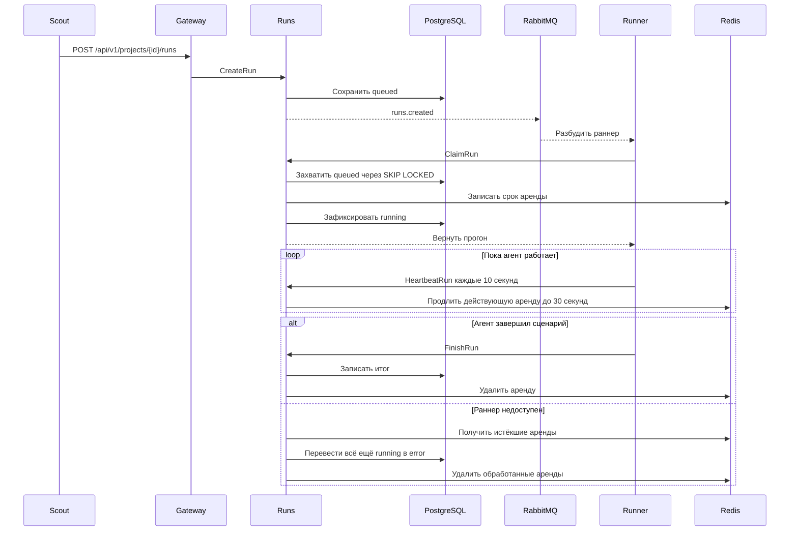

# Архитектура AI Tester

Scout собирается из React и TypeScript. Gateway раздаёт HTML, CSS и JavaScript,
принимает запросы к `/api/v1` с того же адреса и передаёт их внутренним gRPC-сервисам.
Сессия использует HTTP-only cookie. При истечении access-токена параллельные запросы
ждут одного обновления сессии. Списки прогонов и открытый отчёт обновляются в видимой
вкладке. При выборе другого проекта или прогона запросы предыдущего экрана отменяются.

## Захват и освобождение прогона

RabbitMQ доставляет сигнал о появлении работы. Если сигнал потерялся, раннер
повторяет `ClaimRun` с интервалом `RUNNER_POLL_INTERVAL_SECONDS`. PostgreSQL хранит
очередь, состояние прогона и результаты. `ClaimRun` выбирает один прогон из
`queued` через `FOR UPDATE SKIP LOCKED`. Блокировка строки заканчивается вместе
с транзакцией захвата. После этого за исполнение отвечает аренда.

Runs создаёт аренду перед фиксацией `running`. При недоступности Redis транзакция
захвата откатывается, и прогон остаётся в очереди. Аренды хранятся в sorted set Redis.
В `score` записан срок окончания. Lua-скрипт использует время Redis
и атомарно проверяет срок перед продлением. Истёкшая аренда не оживает от запоздавшего
heartbeat. [TIME](https://redis.io/docs/latest/commands/time/) ·
[ZRANGEBYSCORE](https://redis.io/docs/latest/commands/zrangebyscore/)

### Что происходит при падении

- Runs опрашивает Redis каждые 5 секунд и выбирает до 100 истёкших аренд за проход.
  Когда Redis доступен и очередь восстановления мала, переход в `error` происходит
  примерно в течение 35 секунд после последнего успешного heartbeat.
- Для истёкших аренд runs блокирует только строки известных прогонов по первичному ключу.
  Перед переходом в `error` он сверяет состояние под блокировкой. Шаги, находки,
  завершение и учёт токенов требуют состояния `running` и действующей аренды.
- При потере аренды раннер прекращает выполнение и закрывает браузер. Промежуточные
  результаты сохраняются, а слот пользователя освобождается. Повтор сценария
  создаётся явно, поскольку повтор действий на сайте может дублировать их эффект.
- Каждый heartbeat и каждый пустой проход проверки аренд обслуживает Redis.
  После сбоя PostgreSQL получает точечную операцию по затронутым прогонам.
  Проверка 15-минутного лимита по-прежнему запускается раз в минуту. Она также
  завершает прогоны, для которых состояние аренды было потеряно при сбое Redis.

Записи результатов проверяют аренду, удерживая блокировку строки прогона. Это
упорядочивает завершение и восстановление при гонке. Замедление Redis может
увеличить время удержания этой блокировки, поэтому у подключения настроены
таймауты чтения и соединения.

При обновлении существующего развёртывания сначала дождитесь завершения активных
прогонов и обновите runs и runner вместе. Старые раннеры не вызывают `HeartbeatRun`.

## Проверка

Задача `run-lease-recovery` в CI запускает две gRPC-реплики runs на общих
PostgreSQL и Redis. Тест проверяет единственный захват, продление аренды, истечение
без дальнейшего heartbeat, отказ запоздавшему завершению, сохранение шагов и
освобождение слота. В тесте срок принудительно сдвигается в прошлое, чтобы сценарий
выполнялся без ожидания 30 секунд. Отдельный тест раннера проверяет закрытие браузера
при потере аренды.

## Следующие архитектурные шаги

1. Сохранять итог прогона и сгенерированный тест одной транзакцией. Сейчас между
   `FinishRun` и `SaveGeneratedTest` есть окно, в котором сбой оставит итог без теста.
2. Измерять время от постановки до захвата, количество истёкших аренд и задержку
   перехода из `running` в `error`. Эти метрики покажут, справляется ли проверка
   аренд с текущим числом реплик.
3. Выполнять сгенерированные Playwright-тесты отдельной задачей и выставлять
   `verified` по результату повторного запуска.
